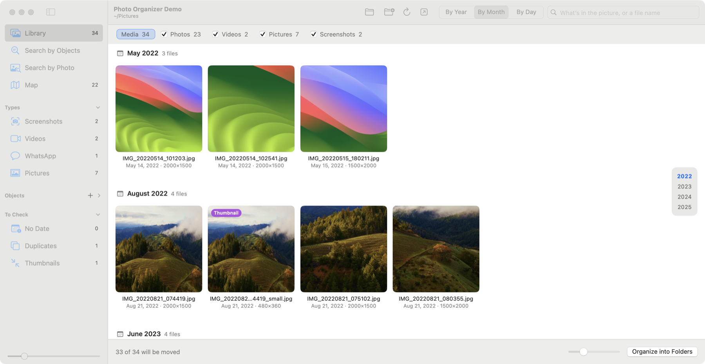

# Photo Organizer

**Sort a messy folder of photos and videos into folders by the real capture date — on your Mac or Windows PC, with
nothing uploaded.**

Photo Organizer is a small native app for macOS (Objective-C / AppKit) and Windows (C# / WPF) for the folder everyone
has: a phone backup, a Google Takeout export, years of “Camera Uploads”. It finds out when every photo and video was
really taken, shows the library the way Apple Photos does, finds duplicates and thumbnails, recognises objects and
people, and — when you ask — moves or copies the files into `2016/`, `2016/07 July/` or `2016-07-14/` folders. Files
are **never renamed or re-encoded**, nothing is ever overwritten, and every move or copy can be undone.

Both versions have the same window, the same date rules, the same folders and the same models. Everything runs
locally. No cloud, no account, no subscription.

[Русская версия ↓](#русский)

<p align="center">
  
</p>

## Download

Get the latest build from [Releases](../../releases) — every change to `main` is built and published automatically.

| | macOS | Windows |
|---|---|---|
| File | `PhotoOrganizer-macOS-vx.y.z.zip` | `PhotoOrganizer-Windows-vx.y.z.zip` |
| System | macOS 12 Monterey or later, Apple Silicon or Intel | Windows 10 or 11, 64-bit |
| Install | unzip, drag `PhotoOrganizer.app` to *Applications* | unzip anywhere, run `PhotoOrganizer.exe` — nothing to install |
| Recognition | Vision and Core ML; MLX on Apple Silicon | ONNX Runtime on the graphics card (DirectML, any DirectX 12 card) or the processor |

**macOS:** the build is not notarized yet, so macOS says it “could not verify” the app. Remove the quarantine flag and
launch it:

```bash
xattr -dr com.apple.quarantine /Applications/PhotoOrganizer.app
open /Applications/PhotoOrganizer.app
```

Or: *System Settings → Privacy & Security* → **Open Anyway** (on macOS 15 “right-click → Open” no longer works).

On a Mac, People and the MLX models need Apple Silicon and Python 3.10+ (or [uv](https://github.com/astral-sh/uv)); the
app sets up its own environment and downloads the models when you turn the feature on in *Settings*. On Windows the
models are downloaded the same way, nothing else is needed.

**Windows:** the exe is not signed yet; if SmartScreen stops it, choose **More info → Run anyway**.

## Features

- **Move or copy** — move the originals into the folders, or leave them where they are and copy them, for example
  from an old drive onto a backup drive. Year folders already on the destination are filled up; a file already copied
  there (same name, size and date) is skipped, and another picture with the same name gets `name (2).jpg` — so the
  copy can be run again at any time and only adds what is new.
- **Organize into folders** — by date: year (default), month or day, with your own folder names and a preview of the
  result where every folder can be renamed before anything moves. Or, first, by another key, with the date folders
  inside or without them:
  - **by type** — Screenshots, Screen Recordings, WhatsApp, Telegram, Viber, Instagram, Videos, Animations, Panoramas,
    RAW, Photos (the media types Photos lists, told by the file's name, folder, format and proportions);
  - **by person** — photos in which exactly one named person was recognised go to a folder with their name;
  - **by format** — JPEG, HEIC, PNG, MOV…
  - **Screenshots to a folder** of their own, whatever the rest is organized by: one folder with the dates inside
    (`Screenshots/2024/…`) or one inside every date folder (`2024/Screenshots/…`). Duplicates and thumbnails likewise.
  - **Remove duplicates** (on by default) — when the files are moved, exact copies and lesser versions go to the
    Trash / Recycle Bin and only the original or the best version is organized (when copied, they are not copied).
    A copy is removed only while its original stays and is still on the disk; thumbnails have their own option.
  - The organize window can be moved and resized: made smaller, its options scroll.
  - Files are moved with an atomic “never replace” rename: a name clash gets a new name, nothing is overwritten.
  - A progress bar, a journal of every move, and **Undo** that puts every file back.
- **Arrange by type and by person** — the sidebar has **Types**: *Screenshots*, *Videos* and every other type found,
  each with its count — screen recordings, WhatsApp, Telegram, Viber, Instagram, animations, panoramas, RAW,
  *Pictures* and *Collages*. Screenshots are told
  by what the file says — the name the system gave it (`Screenshot 2024-…`, `Снимок экрана…`), a folder of
  screenshots, or a PNG the size of a phone, tablet or computer screen (iPhones name them `IMG_1234.PNG`) — and, on a
  Mac, by what the image labels see: a screenshot sent through WhatsApp or Viber comes back as a JPEG under another name.
  - *Collages* are what Google Photos made rather than a camera took — collages, photo frames, animations, movies,
    video snippets, effects (`…-COLLAGE.jpg`, `…-PHOTO_FRAME.jpg`, `MOVIE.mp4`), told by the names Google Photos and
    Takeout give them; an edited copy (`…-отредактировано.jpg`) is still a photo.
  - *Pictures* are postcards, memes, drawings, documents — what WhatsApp and Viber chats fill a phone with. The app
    learns them on your own library: files the image labels call drawn, printed or written are its examples of
    pictures, camera photos and messenger photos of people, animals or the sky its examples of photos, and a small
    model on each file's visual fingerprint sorts the rest (MobileCLIP on Windows, Vision's feature print on a Mac,
    where the examples of every library opened are remembered, so a folder of saved pictures learns from the camera
    roll). A photo of people, animals or the sky with nothing drawn about it stays a photo whatever the model says,
    and what a camera took — a capture date of its own, a place, a camera's name — is a photo whatever is in it.
  - **This Is a Picture / This Is a Photo** in the menu of a file (on a Mac) puts it right: the file moves at once,
    the correction is kept, and it teaches the model, so that files like it follow a second later.
  - Above the library: **Media · Photos · Videos · Pictures · Collages · Screenshots** (Screenshots on a Mac), each
    kind with its count and a checkbox; *Media* counts what the ticked kinds add up to. The kind shown is filled in
    blue. Clicking a kind shows it alone; ticked, it is in *Media* and gets organized, unticked it is hidden and stays where it
    is — the sidebar counts only the ticked kinds too (the library counts everything found), while a type row (*Pictures*, *Collages*…) always shows all of its
    type. **Organize** takes the same checkboxes — set the library to photos and videos, and only they are moved or
    copied into the year folders.
  - **Show Original** in the menu of a copy or a thumbnail shows the file it is a copy of in the library. Removing
    copies or thumbnails never takes the last one: the original has to stay and still be on the disk.
  - **Arrange…** on Screenshots, Pictures, Videos, a person or an object filter puts everything shown into one folder named
    after it (*Screenshots*, *Videos*, *Mum*…), all together or in folders by year, month or day inside — moved, or
    copied to any folder, for example a backup drive, skipping what is already there and filling the year folders
    already on it; a copy can be stopped.
  - Such a folder is kept: organizing by date leaves its files where they are afterwards (the same goes for
    *Move to Folder…*).
- **Several folders at once** — open several folders (or drop them on the window), or add one with the folder-plus
  button: they are scanned together, copies are found across them, and organizing puts everything into one folder —
  the first one, or any other chosen under *Put into*.
- **The real capture date**, not the date the file was copied:
  - EXIF for photos; QuickTime / MP4 metadata for videos (with the 1904 / 1970 epoch bugs of some cameras fixed);
  - a date in the file name (`IMG_20160714_…`, `20220909_145141.mp4`, `IMG-20160714-WA0001`, `Screenshot 2019-07-14…`);
  - Google Takeout `.json` files next to the media — also for the files Takeout gave none of their own: names cut to
    47 characters, numbered and edited copies (`…(1).jpg`, `…-edited.jpg`), the videos of Live Photos;
  - copies of the same shot, and neighbouring frames of the same numbered series;
  - and, when nothing else knows, the year of a Google Takeout folder (`Photos from 2016`, `Фото 2016 г`) — the year
    Google Photos gives the file; it goes into that year's folder, not into a month.
  - Other files with no reliable date are **not guessed into a year**: they go to **No Date**, and **Suggested Dates**
    groups them by rule (“from the folder name *2016*”, “like the neighbouring files IMG_0541 and IMG_0543”) with one
    *Confirm* button per rule. Any date can also be set by hand.
- **Big libraries** — a scan that is interrupted (the app closed, the computer turned off) goes on where it stopped at
  the next launch, and a rescan reads only new and changed files; the same goes for recognition.
- **A library like Apple Photos** — a grid by year, month or day, a year strip on the right to jump through time,
  a built-in viewer for photos and videos with zoom, a **map** of photos with GPS, and *Show in Library* from any
  search result.
- **Duplicates and thumbnails** — exact copies, resized and recompressed versions; *Remove Duplicates* keeps the
  best-quality file of each set and moves the rest to the Trash / Recycle Bin. *Duplicates by Folder…* shows the
  exact copies grouped by the folders they are in and lets you pick the folder that keeps them — folders left with
  nothing else go to the Trash too. A copy is removed only while the file that stays is still there, unchanged in size.
- **Search**
  - **by text**: what’s in the picture, the text written in it (read on the device in Russian and English —
    screenshots, documents, signs) or a file name;
  - **by photo**: drop a picture and get the visually similar ones;
  - **by object**: drop a photo, draw a frame around a thing (a dog, a car, a mug) and find the photos where
    *that* thing appears — by visual similarity, not by tags.
- **People** — faces are found and grouped with an ArcFace model (downloaded on demand), already while the analysis
  runs; face thumbnails in the sidebar, “only photos with this person”, *Find This Person* in the menu of a photo or
  in the search by photo; names and numbers you see stay.
- **Explicit content detection** (optional) — MLX or Core ML on a Mac, ONNX on Windows.
- **VK album download** — sign in to your own VK account in the app and download an album (including *Saved
  photos*) in original size, numbered in the album’s order; an interrupted download resumes where it stopped.
- Drag files out to Finder / File Explorer, adjustable sidebar and thumbnail size.
- No rescans after work: trash, move or undo, and the library updates in place — recognition results are kept per
  file, so they survive moves on the same disk.
- English and Russian interface (follows the system language), light and dark themes.

## Keyboard shortcuts

On Windows, Ctrl stands for ⌘, Shift for ⇧ and Alt for ⌥, except where the table says otherwise.

| Keys | Action |
|---|---|
| ⌘O / ⇧⌘O | Open folders (or drop them on the window) / add another folder; *Open Recent* in the folder menu |
| ⌘↩ | Organize into folders… |
| ⌘F / ⇧⌘F | Search / Search by photo |
| ⌘↓ / ⌘↑ or Esc | Open in the viewer / back to the grid |
| ⌘⌫ | Move to Trash — in the viewer, the photo on screen, then on to the next |
| ⌘C | Copy the selected files (to paste in Finder / File Explorer) |
| ⇧⌘M / ⌥⇧⌘M | Move the selection / everything shown to a folder… (Windows: Ctrl+M / Ctrl+Shift+M) |
| ⌘D | Set date… |
| ⌘1 / ⌘2 / ⌘3 | Group by year / month / day |
| ⌘Z / ⇧⌘Z | Undo / Redo (Windows also Ctrl+Y) |
| ⌘+ / ⌘− / ⌘0 | Thumbnails larger / smaller / usual size; in the viewer zoom in / out / actual size |
| ⌘9 | Fit the picture to the window (viewer) |
| ⌘R / ⇧⌘R | Rescan (Windows also F5) / show the folder in Finder / File Explorer |
| ⌃⌘S | Show or hide the sidebar (Windows: Ctrl+Alt+S) |

## Build from source

**macOS** — only the Xcode Command Line Tools are needed (`xcode-select --install`):

```bash
./build.sh          # → /Applications/PhotoOrganizer.app (universal, ad-hoc signed; a running copy is restarted)
./build.sh --test   # run the core tests first: dates, plan, duplicates, moves, undo
./build.sh --zip    # also write dist/PhotoOrganizer-macOS-v<version>.zip
INSTALL_DIR=~/Applications ./build.sh   # install somewhere else
```

The script is a few plain `clang` calls. It builds in a temporary folder and installs straight into Applications,
leaving nothing inside the project: in iCloud Drive an app bundle turns into a pile of folders, and the attributes
iCloud adds keep `codesign` from signing it.

**Windows** — PowerShell in the repository root, with the [.NET 10 SDK](https://dot.net):

```powershell
.\build.ps1         # → %LOCALAPPDATA%\Programs\PhotoOrganizer\PhotoOrganizer.exe (one self-contained file)
.\build.ps1 -Zip    # also write dist\PhotoOrganizer-Windows-v<version>.zip
```

More about the Windows version: [WindowsApp/README.md](WindowsApp/README.md).

**Releasing**: nothing is built or uploaded by hand. Every push to `main` makes GitHub Actions run the macOS tests,
build both apps and publish them as release `v<VERSION>`, with the version from the `VERSION` file in the repository
root (local builds get the same one). While it stays the same, each push updates that release; change `VERSION` for a
new one.

### How it works

```
macOS — AppKit UI (Objective-C), Sources/
  POScanner      walks the folder, reads EXIF / QuickTime / Takeout dates, sizes, GPS; keeps what it read per file
  POPlan         dates from names, copies and neighbours; groups, duplicates, thumbnails, undated files
  PODateSuggestions  rules for undated files (folder name, file name, neighbouring files…)
  POOrganizer    safe moves (renamex_np RENAME_EXCL), journal, undo
  POAnalyzer     Vision: labels, feature prints, salient objects, faces  → cached per file
  POObjectIndex  object search: fp16 feature prints of the whole photo and up to 3 objects
  POPeople       face grouping ── vit_mlx.py (ArcFace / nudity models on MLX, one long-lived process)
  POVKAlbum      VK API: album pages → original-size downloads, 4 at a time

Windows — WPF UI (C#), WindowsApp/PhotoOrganizer/
  Core/Scanner, ScanCache   the same scan, kept per file
  Core/Plan, Organizer      the same rules and safe moves (MoveFileEx without replace)
  Core/Analyzer             MobileCLIP (labels, object vectors), YuNet + ArcFace (faces), nudity models — ONNX Runtime, DirectML
  Core/VitOnnx              turns the downloaded safetensors weights into ONNX
```

| Where | What |
|---|---|
| `~/Library/Application Support/Photo Organizer` (macOS), `%APPDATA%\Photo Organizer` (Windows) | what scans read, recognition results, object index, the examples and corrections of pictures and photos, dates set by hand, people’s names, the move journal, the VK sign-in token (readable only by you) |
| `~/.cache/huggingface/hub` | downloaded models (the standard Hugging Face cache, shared with other apps) |

The photos and videos themselves are never modified — only moved, when you ask.

## License

MIT — see [LICENSE](LICENSE). Downloaded models keep their authors’ licenses.

---

<a id="русский"></a>

# Photo Organizer (по-русски)

**Раскладывает папку с фото и видео по папкам по настоящей дате съёмки — на Mac или на компьютере с Windows, ничего
никуда не загружая.**

Photo Organizer — небольшое нативное приложение для macOS (Objective-C / AppKit) и Windows (C# / WPF) для папки,
которая есть у всех: бэкап телефона, выгрузка Google Takeout, годы «Camera Uploads». Оно выясняет, когда на самом
деле снят каждый файл, показывает медиатеку как «Фото» от Apple, находит дубликаты и миниатюры, распознаёт объекты и
людей и — когда вы попросите — перемещает или копирует файлы в папки `2016/`, `2016/07 Июль/` или `2016-07-14/`.
Файлы **не переименовываются и не пережимаются**, ничего не перезаписывается, любое перемещение или копирование
можно отменить.

У обеих версий одно и то же окно, те же правила дат, те же папки и те же модели. Всё работает локально: без облака,
аккаунтов и подписок.

<p align="center">
  
</p>

## Скачать

Свежая сборка — в [Releases](../../releases): каждое изменение в `main` собирается и публикуется автоматически.

| | macOS | Windows |
|---|---|---|
| Файл | `PhotoOrganizer-macOS-vx.y.z.zip` | `PhotoOrganizer-Windows-vx.y.z.zip` |
| Система | macOS 12 Monterey или новее, Apple Silicon или Intel | Windows 10 или 11, 64-бит |
| Установка | распаковать, перетащить `PhotoOrganizer.app` в «Программы» | распаковать в любую папку, запустить `PhotoOrganizer.exe` — устанавливать ничего не нужно |
| Распознавание | Vision и Core ML; MLX на Apple Silicon | ONNX Runtime на видеокарте (DirectML, любая с DirectX 12) или на процессоре |

**macOS:** сборка пока не нотаризована, поэтому macOS пишет, что «не удалось подтвердить» приложение. Снимите
карантинную пометку и запустите:

```bash
xattr -dr com.apple.quarantine /Applications/PhotoOrganizer.app
open /Applications/PhotoOrganizer.app
```

Или: «Системные настройки» → «Конфиденциальность и безопасность» → **«Всё равно открыть»** (в macOS 15 «правый клик →
Открыть» больше не работает).

На Mac для людей и моделей MLX нужны Apple Silicon и Python 3.10+ (или [uv](https://github.com/astral-sh/uv)) —
окружение и модели приложение ставит само, когда вы включаете функцию в «Настройках». В Windows модели скачиваются так
же, больше ничего не нужно.

**Windows:** exe пока не подписан; если SmartScreen его остановит, нажмите **«Подробнее» → «Выполнить в любом случае»**.

## Возможности

- **Переместить или скопировать** — оригиналы переезжают в папки или остаются на месте, а в папки кладутся копии —
  например, со старого диска на диск для бэкапа. Папки годов, которые уже есть в месте назначения, пополняются; файл,
  который там уже есть (то же имя, размер и дата), пропускается, а другое фото с тем же именем получает имя
  `имя (2).jpg` — поэтому копирование можно запускать повторно, и оно добавит только новое.
- **Раскладка по папкам** — по датам: годам (по умолчанию), месяцам или дням, со своими названиями папок и
  предпросмотром, где любую папку можно переименовать, пока ничего не перемещено. Или сначала по другому признаку — с
  папками дат внутри или без них:
  - **по типам** — скриншоты, записи экрана, WhatsApp, Telegram, Viber, Instagram, видео, анимации, панорамы, RAW,
    фото (типы медиа, как в «Фото», по имени файла, папке, формату и пропорциям);
  - **по людям** — фото, где узнан ровно один названный человек, попадают в папку с его именем;
  - **по форматам** — JPEG, HEIC, PNG, MOV…
  - **Скриншоты — в отдельную папку** при любой раскладке: одна папка с датами внутри (`Скриншоты/2024/…`) или
    внутри папки каждой даты (`2024/Скриншоты/…`). Так же — дубликаты и миниатюры.
  - **«Удалить дубликаты»** (включено по умолчанию) — при переносе точные копии и уменьшенные версии уходят в Корзину,
    а раскладывается только оригинал или лучшая версия (при копировании они просто не копируются). Копия удаляется,
    только если её оригинал остаётся и лежит на диске; у миниатюр своя галочка.
  - Окно раскладки можно двигать и менять его размер: если сделать его меньше, настройки прокручиваются.
  - Перемещение — атомарное переименование «без замены»: при совпадении имён файл получает новое имя, ничего не
    перезаписывается.
  - Прогресс, журнал всех перемещений и **отмена**, которая возвращает каждый файл на место.
- **Раскладка по типам и по людям** — в боковой панели раздел **«Типы»**: *«Скриншоты»*, *«Видео»* и все остальные
  найденные типы со счётчиками — записи экрана, WhatsApp, Telegram, Viber, Instagram, анимации, панорамы, RAW,
  *«Картинки»* и *«Коллажи»*. Скриншоты
  узнаются по тому, что говорит сам файл: имя, которое дала система (`Screenshot 2024-…`, `Снимок экрана…`), папка
  скриншотов или PNG размером с экран телефона, планшета или компьютера (iPhone называет их `IMG_1234.PNG`), а на Mac
  ещё и по меткам распознавания: скриншот, пересланный через WhatsApp или Viber, приходит как JPEG под другим именем.
  - *«Коллажи»* — то, что сделал Google Фото, а не камера: коллажи, рамки, анимации, фильмы, фрагменты видео,
    эффекты (`…-COLLAGE.jpg`, `…-PHOTO_FRAME.jpg`, `MOVIE.mp4`) — по именам, которые дают им Google Фото и Takeout;
    отредактированная копия (`…-отредактировано.jpg`) остаётся фото.
  - *«Картинки»* — открытки, мемы, рисунки, документы: то, чем чаты WhatsApp и Viber забивают телефон. Программа учится
    на вашей же медиатеке: файлы, которые метки распознавания называют нарисованными, печатными или написанными, —
    её примеры картинок, снимки с камеры и присланные фото людей, животных или неба — примеры фото, а небольшая модель
    на «отпечатке» каждого файла разбирает остальное (в Windows — MobileCLIP, на Mac — отпечаток Vision; на Mac
    примеры всех открытых медиатек запоминаются, поэтому папка сохранённых картинок учится на фото с камеры). Фото
    людей, животных или неба, в котором нет ничего нарисованного, остаётся фото, что бы ни сказала модель, а снятое
    камерой — со своей датой съёмки, местом или «камерным» именем — фото, что бы на нём ни было.
  - **«Это картинка» / «Это фото»** в меню файла (на Mac) исправляет ошибку: файл сразу переходит куда нужно,
    поправка запоминается и учит модель, так что похожие файлы через секунду переходят следом.
  - Над медиатекой: **Медиа · Фото · Видео · Картинки · Коллажи · Скриншоты** («Скриншоты» — на Mac), у каждого вида —
    счётчик и галочка; «Медиа» — сумма отмеченных. Показанный вид залит синим. Нажатие на вид
    показывает только его; отмеченный вид входит в «Медиа» и раскладывается, без галочки — скрыт и остаётся на месте;
    счётчики слева тоже считают только отмеченные виды (медиатека — все найденные файлы), а строка типа («Картинки», «Коллажи»…) всегда показывает весь свой тип.
    **«Разложить»** берёт те же галочки: отметили в медиатеке фото и видео — по годам переносятся или копируются только они.
  - **«Показать оригинал»** в меню копии или миниатюры показывает в медиатеке файл, копией которого она является.
    Удаление копий и миниатюр никогда не трогает последнюю: оригинал должен остаться и быть на диске.
  - **«Разложить…»** в «Скриншотах», «Картинках», «Видео», у человека или фильтра объектов складывает всё показанное в одну папку
    с его названием («Скриншоты», «Видео», «Мама»…) — всё вместе или по папкам годов, месяцев или дней внутри,
    с переносом или с копированием в любую папку, например на диск-архив: уже скопированное пропускается, годовые
    папки на диске заполняются; копирование можно остановить.
  - Такая папка закрепляется: общая раскладка по датам потом оставляет её файлы на месте (так же и после
    «Переместить в папку…»).
- **Несколько папок сразу** — откройте несколько папок (или перетащите их на окно) или добавьте ещё одну кнопкой с
  плюсом: они сканируются вместе, дубликаты ищутся между ними, а раскладка складывает всё в одну папку — первую или
  любую другую, выбранную в строке «Куда сложить».
- **Настоящая дата съёмки**, а не дата копирования:
  - EXIF у фото; метаданные QuickTime / MP4 у видео (с исправлением ошибок эпохи 1904 / 1970 у некоторых камер);
  - дата в имени файла (`IMG_20160714_…`, `20220909_145141.mp4`, `IMG-20160714-WA0001`, `Screenshot 2019-07-14…`);
  - файлы `.json` из Google Takeout рядом с медиа — и для файлов, которым Takeout своего не дал: имена, обрезанные
    до 47 знаков, пронумерованные и отредактированные копии (`…(1).jpg`, `…-отредактировано.jpg`), видео из Live Photo;
  - копии того же снимка и соседние кадры одной нумерованной серии;
  - и, если больше ничего не известно, год папки Google Takeout (`Фото 2016 г`, `Photos from 2016`) — год, который
    файлу даёт Google Фото; файл попадает в папку этого года, но не в месяц.
  - Остальным файлам без надёжной даты год **не придумывается**: они попадают в **«Без даты»**, а раздел **«Предполагаемые
    даты»** группирует их по правилам («из названия папки *2016*», «как у соседних файлов IMG_0541 и IMG_0543») с кнопкой
    *«Подтвердить»* для каждого правила. Любую дату можно задать вручную.
- **Большие медиатеки** — прерванное сканирование (приложение закрыли, компьютер выключился) при следующем запуске
  продолжается с того же места, а повторное читает только новые и изменённые файлы; так же и с распознаванием.
- **Медиатека как в «Фото»** — сетка по годам, месяцам или дням, полоса годов справа для быстрого перехода,
  встроенный просмотр фото и видео с масштабированием, **карта** снимков с GPS и *«Показать в медиатеке»* из любой выборки.
- **Дубликаты и миниатюры** — точные копии, уменьшенные и пережатые версии; *«Удалить дубликаты»* оставляет файл
  лучшего качества из каждого набора, остальные перемещает в Корзину. *«Дубликаты по папкам…»* показывает точные копии,
  собранные по папкам, где они лежат, и даёт выбрать папку, которая их сохранит, — папки, где больше ничего не останется,
  тоже уходят в Корзину. Копия удаляется, только если оставляемый файл на месте и его размер не изменился.
- **Поиск**
  - **по тексту**: что на снимке, написанный на нём текст (читается на устройстве, по-русски и по-английски —
    скриншоты, документы, вывески) или имя файла;
  - **по фото**: перетащите снимок — найдутся похожие;
  - **по предмету**: перетащите фото, обведите рамкой предмет (собаку, машину, кружку) — найдутся снимки, где есть
    *именно он*, по визуальному сходству, а не по тегам.
- **Люди** — лица находятся и группируются моделью ArcFace (скачивается по желанию) уже во время распознавания;
  миниатюры лиц в боковой панели, «только фото с этим человеком», *«Найти этого человека»* в меню фото и в поиске
  по фото; заданные имена и номера сохраняются.
- **Распознавание откровенных снимков** (по желанию) — MLX или Core ML на Mac, ONNX в Windows.
- **Загрузка альбома ВК** — войдите в свой аккаунт прямо в приложении и скачайте альбом (в том числе «Сохранённые
  фотографии») в оригинальном размере, с нумерацией в порядке альбома; прерванная загрузка продолжается с того же места.
- Перетаскивание файлов в Finder / Проводник, масштаб боковой панели и размера миниатюр.
- Без пересканирования: после удаления, перемещения или отмены медиатека обновляется на месте — результаты
  распознавания хранятся для каждого файла и переживают перемещение в пределах диска.
- Английский и русский интерфейс (по языку системы), светлая и тёмная тема.

## Сочетания клавиш

В Windows вместо ⌘ — Ctrl, вместо ⇧ — Shift, вместо ⌥ — Alt, если в таблице не сказано иначе.

| Клавиши | Действие |
|---|---|
| ⌘O / ⇧⌘O | Открыть папки (или перетащите их на окно) / добавить ещё папку; *«Открыть недавние»* — в меню папки |
| ⌘↩ | Разложить по папкам… |
| ⌘F / ⇧⌘F | Поиск / Поиск по фото |
| ⌘↓ / ⌘↑ или Esc | Открыть в просмотре / вернуться к сетке |
| ⌘⌫ | Переместить в Корзину — в просмотре фото на экране, затем следующее |
| ⌘C | Скопировать выбранные файлы (чтобы вставить в Finder / Проводник) |
| ⇧⌘M / ⌥⇧⌘M | Переместить выбранное / всё показанное в папку… (Windows: Ctrl+M / Ctrl+Shift+M) |
| ⌘D | Задать дату… |
| ⌘1 / ⌘2 / ⌘3 | По годам / месяцам / дням |
| ⌘Z / ⇧⌘Z | Отменить / Повторить (в Windows ещё Ctrl+Y) |
| ⌘+ / ⌘− / ⌘0 | Миниатюры крупнее / мельче / обычного размера; в просмотре — увеличить / уменьшить / реальный размер |
| ⌘9 | Фото по размеру окна (просмотр) |
| ⌘R / ⇧⌘R | Пересканировать (в Windows ещё F5) / показать папку в Finder / Проводнике |
| ⌃⌘S | Показать или скрыть боковую панель (Windows: Ctrl+Alt+S) |

## Сборка из исходников

**macOS** — нужны только Command Line Tools (`xcode-select --install`), Xcode не обязателен:

```bash
./build.sh          # → /Applications/PhotoOrganizer.app (универсальная; запущенная копия перезапускается)
./build.sh --test   # сначала тесты ядра: даты, план, дубликаты, перемещения, отмена
./build.sh --zip    # ещё и dist/PhotoOrganizer-macOS-v<версия>.zip
INSTALL_DIR=~/Applications ./build.sh   # поставить в другое место
```

Скрипт — несколько обычных вызовов `clang`. Сборка идёт во временной папке и ставится сразу в «Программы», в папке
проекта ничего не остаётся: в iCloud Drive приложение превращается в кучу папок, а атрибуты iCloud не дают `codesign`
его подписать.

**Windows** — PowerShell в корне репозитория, нужен [.NET 10 SDK](https://dot.net):

```powershell
.\build.ps1         # → %LOCALAPPDATA%\Programs\PhotoOrganizer\PhotoOrganizer.exe (один самодостаточный файл)
.\build.ps1 -Zip    # ещё и dist\PhotoOrganizer-Windows-v<версия>.zip
```

Подробнее о Windows-версии — [WindowsApp/README.md](WindowsApp/README.md).

**Релиз**: вручную ничего не собирается и не загружается. При каждом пуше в `main` GitHub Actions прогоняет тесты,
собирает обе версии и публикует релиз `v<VERSION>` с версией из файла `VERSION` в корне (у локальной сборки та же).
Пока версия не меняется, каждый пуш обновляет этот релиз; для нового релиза поменяйте `VERSION`.

## Где хранятся данные

`~/Library/Application Support/Photo Organizer` на Mac и `%APPDATA%\Photo Organizer` в Windows — прочитанное при
сканировании, результаты распознавания, индекс предметов, примеры и поправки картинок и фото, заданные вручную даты, имена людей, журнал перемещений и
токен входа ВК (доступен только вам). Скачанные модели — в общем кеше Hugging Face `~/.cache/huggingface/hub`. Сами
фото и видео приложение не изменяет — только перемещает, когда вы об этом просите.

## Лицензия

MIT — см. [LICENSE](LICENSE). Скачиваемые модели распространяются по лицензиям их авторов.
